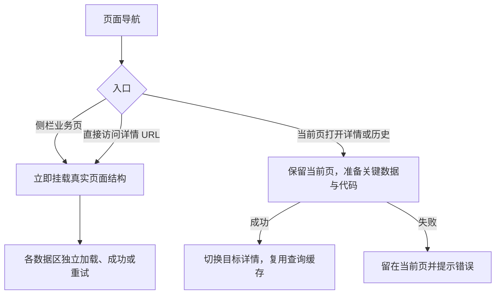

> 修订副本：2026-10-27。保留用户提供的原始资料；相邻文档链接沿用原规范目录语境，回迁时与原文档集一起使用。本文不代表 Portal／Admin 已完成接入或组件包已发布。

# Qways 前端界面工程规范

本文适用于开放平台 `web/portal/**` 和管理后台 `web/admin/**` 的所有界面开发。页面的信息架构、业务作用域与交互规则见[03-07 前端页面设计指南](./03-07-前端页面设计指南.md)；API、权限和数据含义以各自的接口合同为准。本文是组件、样式与异步加载体验的统一规则；现有页面是否完成接入须以实现和验证为准。

## 1. 组件与依赖

- 两端界面统一使用 GitHub 启智组件库发布包 `@wangxiaojinger/qizhi-react` 和 `@wangxiaojinger/qizhi-tokens`，以各端 `AGENTS.md`、依赖声明和 lockfile 为准。`web/qizhi-react/`、`web/qizhi-tokens/`、内部 adapter 及 `web/vendor/qizhi/` 的历史源码或快照不作为发布组件的替代实现。先查实际安装包的公开导出，再选择按钮、表单、表格、标签、反馈、空态、抽屉、菜单、排版、图标和图表等组件。
- 使用组件的公开属性和组合能力，不复制组件库源码到业务目录，不用普通 `div` 模拟已有的交互组件。
- 组件库不能满足某项交互或可访问性要求时，可选用其他成熟控件，并将其主题映射到同一套设计变量。选择依据是功能完整、键盘可用和样式一致。
- `web/shared/**` 只承载两端共用、以值和回调为输入的纯展示能力；API 请求、会话状态、路由和权限判断留在各自应用中。

## 2. 设计变量与样式

- 在应用入口引入实际发布包的 `@wangxiaojinger/qizhi-react/style.css`。颜色、字体、圆角、阴影和间距优先使用组件包公开的 CSS 变量；核对实际安装包的 token 与样式定义，避免用历史工作区实现推断当前组件行为。
- 常用变量包括背景 `--color-bg-1`、文本 `--color-text-1/2/3`、边框 `--color-border-1/2`、主色 `rgb(var(--primary-6))`、字体 `--font-sans` 和圆角 `--border-radius-medium/large`。语义状态使用组件属性或对应变量。
- 页面 CSS 负责网格、宽度、间距、响应式布局和业务容器。避免散落覆盖 `.qizhi-*` 内部后代选择器；先核对实际发布包与项目覆盖，项目布局兼容集中在共用样式并说明理由，组件自身缺陷反馈到启智库来源维护，不修改 node_modules 或历史内部实现作为正式修复。
- 新样式不要散落硬编码颜色、重复定义状态色或大量使用 `!important`。其他控件的主题也应映射到启智变量。

## 3. 页面结构与状态

- 顶部栏、侧栏和内容区保持一致的布局节奏。页面标题、主操作、筛选区、内容卡片和详情区域按任务顺序排列。
- 同时检查 1440px 桌面和 375px 手机宽度。表格可以在自身容器内横向滚动，整个文档不应横向溢出。
- 加载、空列表、请求失败、权限不足、禁用和危险操作均有明确呈现。缺失或请求失败后未知的数据用普通短横线 `-`（U+002D）占位，不显示成零；表格内遵循下文统一占位符规则。
- 保持中文和英文文案、键盘操作、可见焦点、可访问名称和足够的文字对比度；图标按钮必须有名称。
- 调整界面时保留页面的字段、入口、操作、校验、请求行为和权限提示。

### 3.1 异步数据与页面切换

- 侧栏切换列表、总览、用量或设置页时，立即挂载真实页面结构，保留页面与可本地化子区块标题、操作、筛选、各数据容器及固定说明，再由各区块独立加载。页面代码须在导航可点击前就绪，不以整页骨架或通用加载卡片代替目标页。
- 加载提示只占据动态数据区：KPI 的数值、图表的绘图区、表格的数据行；保留标签、说明、筛选、列头和布局。`Card loading` 仅用于整张卡片内容都由远端决定的场景，避免遮住固定文案。
- 请求失败时保留页面框架及原位置的重试入口，不能让异常使整个页面消失。同一授权作用域内背景刷新时保留已有数据并给出适度提示；资源名称的可见性租约到期或作用域变化时，必须按[03-10 §5.2](./03-10-前端资源解析、引用与动态本地化.md#52-缓存和生命周期)先停止展示旧值。
- 搜索建议、辅助名称解析等次要数据可以安静加载；不应让它们阻塞页面框架或主操作。
- 从当前页打开详情或历史快照时，先预取关键数据和目标代码，全部就绪后再切换。等待期间保留当前内容并向触发控件反馈；失败时留页，按统一 envelope 显示错误。直接访问详情 URL 时，在目标页局部加载。键盘、修饰键、新标签页和浏览器历史导航保持标准链接行为。
- 详情预取与目标页共用查询键、参数和失效策略，切换后复用缓存。

### 3.2 按可见需求请求数据

- 应用壳层只请求持续可见的轻量数据，例如通知未读数；通知列表与正文在进入通知页后加载。页面刷新不能顺带读取用户尚未打开的详情列表。
- 进入详情页只请求当前视图立即展示所需的数据。未激活的 Tab、折叠区、历史抽屉和二级页面在用户打开时再请求；隐藏组件仍挂载时，也必须用激活状态约束查询。
- 从当前页点击详情时的预取只覆盖目标页首屏关键数据及代码，不延伸到详情中的隐藏 Tab。前一节的“切换前准备就绪”以这个范围为限。
- 查询键包含 Surface、资源作用域、筛选词和分页参数。切换作用域或条件时重置旧游标，并确保旧请求返回后不会覆盖当前视图；同一授权作用域内的缓存可按现有失效策略复用。
- 游标翻页只更新对应列表的数据区域；保留页面壳层、Tab、标题、筛选和其他独立区块。同一授权作用域下，新页请求期间可保留旧页内容以避免整页闪烁，结果到达后列表和依赖该页的详情一起切换。切换授权作用域时不能沿用旧数据。
- 分页列表的筛选必须由服务端在游标分页之前执行：筛选字段属于 OpenAPI 请求合同、React Query 请求与查询键。筛选变化时必须清除游标并从第一页重新查询。不得对当前页 `items` 做内存 `.filter()` 来冒充列表筛选；这会使空页和“下一页”脱离真实结果集。纯展示转换、非分页的已加载选项集合和服务端搜索结果的渲染不属于此限制。
- 按需加载不改变服务端鉴权要求，也不以界面隐藏代替权限判断。无读取权限的子区块不应发起查询。

### 3.3 输入触发的请求与写入提交

- 自由输入会改变远程查询参数、候选搜索或逐页补充数据时，输入框保留即时更新的草稿值，请求使用停止输入约 200–300 毫秒后的提交值。每次输入取消上一轮待提交计时；请求键使用提交值，避免每个字符发一次请求。共享资源选择器及无候选权限时的手输 ID 回退也遵守此规则。
- 清空输入和明确点击搜索或按回车应立即提交；远程筛选值真正改变时再重置游标到第一页。等待防抖期间不要把旧关键词的候选当作新关键词的结果；已发出的旧请求不能覆盖新条件。
- 本地已加载集合的即时过滤、下拉选项点击、状态切换、日期选择和未提交表单的编辑无需防抖。是否延迟以是否会产生连续远程请求为准，不因控件名称包含“搜索”就一律延迟。
- 写操作由明确提交触发，并使用公共写请求层的幂等 key 与提交中的禁用或进度反馈。HTTP 幂等只保证同一凭据、接口、key 与原始请求指纹在短期窗口内的成功重放；不同 key 或请求内容、无 key 请求、查询与推理不因此去重。它不能替代远程读防抖，也不会省去重复请求的网络与服务端入口开销。细节见[04-08 §3](./04-08-通用幂等与业务去重.md#3-http-短期幂等)。

### 3.4 时间横轴图表

- Portal 与 Admin 的时间趋势图、柱状图以本次查询的起止范围及小时或日粒度生成完整横轴，包含无记录的时间桶。共用 `web/shared/src/usage-analytics.ts` 的 `usageBucketDomain` 和用量聚合补齐能力；日桶按查询时区的本地日期，小时桶按实际 UTC 时刻，结束边界不包含在内。切换范围后必须同步更新横轴，不从返回的稀疏记录推算范围。
- 请求数、Token 和金额等可加指标在已成功取得结果且时间桶无记录时补零；SLA、占比和均值在分母不存在时保持无数据。加载中、请求失败或分页分组尚未完整时，不把未知数据当作已确认的零；分页不完整时继续明确提示。
- 验证空结果、首尾与中间缺失桶、跨月及小时跨日、不同查询时区、范围切换和模型分组；图表与总量使用同一查询口径。

### 3.5 大列表的双向游标与批内分页

已确认：凡页面主列表、详情内嵌列表及 Modal/Drawer 浏览列表使用游标接口，均接入本节通用分页。普通管理列表保留每个展示页 8 条及单页隐藏；日志、历史等可按布局设置展示行数。下拉框、选择器内部的游标加载单独列为待确认范围，保留原交互。没有游标接口的列表、仪表盘统计汇总和概览预览不通过伪造游标接入。

#### 数据与游标合同

- 每次接口请求取一批记录；`page_size = 展示页行数 × 批内页数`。默认批内 10 页，日志每页 10 条对应 100 条，普通管理列表每页 8 条对应 80 条。通用组件分别支持 `pageSize` 和 `pageCount`，不得硬编码与请求不符的行数。批内页数为 `ceil(items.length / pageSize)`，最后一页允许不足 `pageSize` 条。批内切页只切换当前数组的展示范围，不发请求。
- 接口必须返回可独立使用的前、后游标；向前查询更新的一批，向后查询更早的一批。请求日志使用 `before_cursor` 与 `cursor`，响应使用 `previous_cursor` 与 `next_cursor`。其他接口的字段名以各自 OpenAPI 合同为准。向前、向后和无游标首批请求均保留相同的授权范围、搜索、筛选、时间区间和稳定排序；排序包含唯一 ID 作为同值记录的最终排序键。
- 前端只保留当前一批记录、当前批的两个响应游标、批次位置和批内页位置；不保存历史批次数据或历史游标栈，不用之前访问过的批次缓存代替跨批查询。批次切换必须发起新请求；同批内切页不重新请求当前批。
- 服务端在同一查询条件下凑齐请求的批次行数后返回，记录不足表示到达该方向的数据边界；不能因为读取窗口、权限过滤或内部扫描分段提前结束，却把不完整批次当作完整数据边界。前端不根据已有页码、当前记录数或推算总数伪造游标。
- 当前批少于 100 条时，只按实际记录数生成页码，不提供向后跨批按钮及右侧省略号。该方向已耗尽时服务端也不应继续返回对应游标；普通向后查询若出现不完整批次与后续游标相矛盾，作为接口合同问题处理，不能展示不存在的数据页。反向查询到达新首边界时按下文无游标重查规则恢复；不能把另一方向的恢复游标误判为合同问题。
- 页码表示当前查询遍历中的展示位置，不是精确总页数，不提供任意远端页跳转、跳页输入或虚构总条数。实时增删可能使重新查询的一批内容变化，不承诺跨批快照或固定历史页内容。

#### 页码组成与跨批动作

页码及两侧省略号的外侧分别放置上一页、下一页箭头，按用户当前展示页逐页切换。箭头与点击相邻页码使用同一入口：第 10 页点击右箭头等同点击第 11 页并查询下一批，第 11 页点击左箭头等同点击第 10 页并按既定规则重查前一批。没有相邻可达页或正在加载时禁用对应箭头，禁用态置灰；省略号仍只作提示。单页时继续遵循整个分页器隐藏的规则。

设当前批从展示页 `S` 开始，实际有 `P` 个批内页：

| 位置 | 展示条件 | 点击行为 |
|---|---|---|
| 左侧省略号 `...` | 当前批之前还有更早的展示页码区间 | 只作提示，无点击、跳页或加载行为 |
| 左侧边界页码 `S - 1` | 当前批不是首批，且接口提供前向游标 | 使用前向游标重新查询前一批，成功后定位到该批实际最后一个批内页 |
| 当前批页码 `S` 至 `S + P - 1` | 只生成当前批实际存在的页 | 在当前 100 条内切换每页 10 条的展示范围 |
| 右侧边界页码 `S + 10` | 当前批有完整 100 条，且接口提供后向游标 | 使用后向游标查询后一批，成功后定位到其第一个批内页 |
| 右侧省略号 `...` | 右侧边界页码存在 | 只作提示，无点击、跳页或加载行为 |

- 每侧最多一个跨批边界页码；不渲染尚未查询批次的其他页码。省略号不是“还有精确多少页”的声明。
- 首次查询不带任何游标，当前批从第 1 页开始，第 1 页高亮。若有完整 100 条且仍有后续数据，展示 `1 2 3 4 5 6 7 8 9 10 11 ...`；其中 1–10 是批内页，11 是向后跨批入口。
- 点击 11 后查询后一批。成功时展示 `... 10 11 12 13 14 15 16 17 18 19 20 21 ...` 并高亮 11；10 是前向入口，21 是后向入口。点 10 时重新请求前一批，完成后高亮其实际最后一页。
- **回到前端认为的首批时，必须按无游标请求重查首批**，不使用旧首批数据，也不使用前向游标恢复旧首批边界。查询成功后定位实际最后一页：满批高亮 10，不足 100 条则高亮实际最后页。首批随后使用新响应中的前后边界。反向查询因并发删除而返回不足一批（包括空批）时，也按无游标重查首批并定位实际最后页，避免停在没有可用翻页入口的空批。向后查询因并发删除返回空批时也无游标重查首批，定位第 1 页；首批本身为空时保留空态，不循环查询。
- 满批但无后向游标时只展示当前批的 10 个页码。例如末批为首批时展示 `1 2 3 4 5 6 7 8 9 10`，不追加 11 或右侧省略号。
- 后一批只有 11–20 条时，实际有两页，展示 `... 10 11 12`，不追加 13 或右侧省略号；有前向游标时仍可通过 10 返回前一批。
- 搜索、筛选、相关 Tab 或授权范围变化时，清除当前批游标与位置，按新条件从首批第 1 页查询。显式刷新也重新请求；不能因批内页切换意外清除筛选条件。

#### 加载、失败与页码样式

- 跨批请求期间保留同一授权范围下当前可见批内页，并在列表区域显示局部加载；页面壳层、标题、筛选和其他面板保持挂载。请求成功后一次性更新记录、游标、批次位置与高亮页。请求失败时保留原批和原高亮，提供重试，不提前显示目标批已加载成功。
- 跨批查询期间禁用重复翻页提交；旧请求不得覆盖新筛选或新作用域的结果。授权范围变化时不能保留旧范围的记录。空结果保留现有空态，不合成 10 个页码；并发删除导致后续批次为空时，应能通过真实前向游标恢复或重新查询首批，不能陷入无入口的空页。
- 分页位于当前列表右下角。非当前页的按钮弱化边框和背景，默认透明，只在鼠标悬停该页码的按钮范围时显示背景反馈，不扩大到分页栏或相邻按钮。
- 当前页保持主题高亮；悬停不改变当前页颜色、背景或边框，重复点击当前页不触发翻页或请求。当前页使用 `aria-current="page"`；页码按钮保留明确的键盘焦点样式。
- 边界页码沿用普通非当前页的视觉样式，并提供“查询前一批，定位第 N 页”或“查询后一批，定位第 N 页”的可访问名称，不能暗示它已存在于当前批内。省略号不可点击、不可聚焦。
- 复用现有组件库公开的按钮及主题变量，不修改全局 Pagination 默认值，不为大列表模式改变普通管理列表或特殊场景的分页方式。

#### 通用组件接入

Portal 与 Admin 统一复用 `@qways/web-shared` 导出的 `useCursorBatchPagination` 和 `CursorBatchPagination`。前者处理当前批加载、批内切页、双向跨批、重置、失败重试和过期响应隔离；后者渲染页码。页面不再复制分页 hook 或维护自己的游标栈。

页面通过稳定的 `load(pagination)` 回调调用自己的接口，传入既有搜索、筛选及授权范围，并将结果适配为 `{ items, previous_cursor?, next_cursor? }`。分页参数为 `{ page_size: pageSize * pageCount, cursor?, before_cursor? }`；接口字段不同可在回调内映射。搜索、筛选或范围改变时更新回调；同条件重新提交或业务操作后的失效刷新可更新 `resetKey`，此时复用当前分页状态并保留原记录和高亮，查询成功后才切到首批第 1 页；只有查询条件、授权范围或启用状态变化才创建新的空分页状态。用返回的 `items` 渲染列表，将 `pagination` 展开传入分页组件，额外提供本地化标签。`isFetching` 用于列表局部加载，`error`、`retry` 用于错误提示和重试。

通用层不导入两端生成客户端，也不处理鉴权或业务查询缓存。只要接口支持稳定排序、与组件配置相符的完整批次和可独立使用的双向游标，即可按此方式复用；只有后向游标的接口需要先升级合同及服务端实现。主列表与内嵌浏览列表的迁移范围已确认；下拉选择器仍须单独确认。

#### 已确认接入范围

以下页面及内嵌浏览列表采用真实双向游标；一般为每批 80 条／展示页 8 条，日志及历史一般为每批 100 条／展示页 10 条。接口 `page_size` 上限至少支持所需批次，服务或数据库层不得再次截断。

| 端 | 已接入页面 | 接口 |
|---|---|---|
| Portal | 请求日志 | `inference_request_list` |
| Portal | 账号／空间审计 | `audit_list` |
| Portal | 资金流水、账单 | `wallet_ledger_list`、`billing_statement_list` |
| Admin | 请求检索、平台审计 | `request_list`、`audit_list` |
| Admin | 请求结算、账单核查、收款主列表 | `settlement_list`、`statement_list`、`billing_receipt_list` |
| Admin | 修复任务、数据导出任务 | `repair_list`、`export_list` |

补充接入：Portal API Key、模型目录、空间项目、空间／项目成员与邀请、通知；Admin 空间管理、平台用户及其成员关系、后台授权、三方帐号及 Token 历史、通知与登录方式、空间项目／成员／API Key／套餐、钱包／账单／审计内嵌列表、供应商资源及影响范围／版本历史、模型／特征／元数据及价格／视图版本历史、配额及预授权历史、套餐模板与订阅、营销活动与命中、归档任务、收款核销明细及浏览账单表。保留所有业务筛选，按 SQL 条件在 LIMIT 前执行；成员与邀请使用 `invitations_only` 分别驱动后端查询。资源影响接口按目标与模型的关联记录组成完整批次，同批展示时可合并相同目标。

空间和项目切换已确认保留仅向后加载的滚动交互：搜索复用对应 list 接口；先用包含正常状态的条件加载，再用排除正常状态的条件补齐本轮候选，两个阶段分别维护 ID 游标。已加载候选即时展示；重复 ID 以较晚返回的记录和位置为准，按去重后的数量补齐。包含与排除状态条件可以组合。Portal 原有独立空间、项目搜索接口已移除。

Portal 请求日志、用量分析和体验中心的 API Key 选择已确认复用 `credential_list` 的搜索与游标加载；搜索候选同样逐页加载，体验中心的可用状态及未过期条件由 SQL 筛选。选中项名称回查也复用 list；Portal 和 Admin 独立 `credential_search` 均已移除。API Key 主列表保持双向游标页码分页，下拉框保留滚动加载。

Portal 请求日志和体验中心的模型选择也复用 `model_list`，普通候选和搜索候选均按每批 50 条滚动加载；搜索不再截断为首批 20 条，按模型标识去重。加载后续批次时保留候选和滚动位置，空间、语言或搜索条件变化时隔离游标及结果。

请求日志的模型筛选支持输入任意完整 `model_name` 后直接回车，也可从模型目录候选中选择；历史请求的模型名不要求存在于当前目录。提交时按输入原值精确筛选请求日志，不查询目录详情来校验它是否存在；体验中心仍只使用目录内候选。

Portal 成员访问范围、空间审计和用量分析的项目选择已通过共用 project list 加载逻辑覆盖；项目预算按当前项目上下文展示，没有额外待迁移的资源下拉。

Admin 通用空间、项目、逻辑模型、API Key、套餐模板、供应商和有平台用户目录权限的用户选择，均复用对应 list 接口的搜索和游标，每批 50 条。创建空间套餐、空间所有者、空间 API Key 项目、项目预算、模型视图绑定和三方帐号绑定用户的选择也使用这一模式。搜索按作用域隔离并防抖，清空立即生效；追加批次保持候选和滚动位置，以 ID 去重，失败时保留候选并提供重试。API Key list 新增 `search`，套餐模板 list 新增 `query`，均由 SQL 在分页前执行。价格版本选择已采用原有游标加载，保留其版本语义。

Admin 供应商帐号、凭据、端点、模型供给和调用组合的选择也复用各自 list，搜索名称／完整 ID 和状态条件在 SQL 的 LIMIT 前执行。兼容调用组合候选继续使用专用 `invocation_target_candidates`，增加 `query` 并支持搜索游标；保留能力、接口、规格、可选性及拒绝原因，不能替换成普通调用组合列表。模型特征 list 支持特征码／本地化展示名搜索；收款核销账单选择使用 statement list 的搜索、finalized 与 unpaid_only；新增后台授权候选使用 identity list 的 `has_platform_role: false`。这些选择器均按每批 50 条滚动加载，筛选变化重新开始。

SQL 优先由资源主表驱动并按稳定键执行游标分页。凭据所属供应商、调用组合所属帐号仍复用已有索引子查询；用户有无角色使用角色分配表主键的 EXISTS；账单未付金额复用既有财务明细求和。它们保留业务语义，不通过拉完游标或浏览器过滤代替 SQL；名称搜索不增加全量结果排序。

仅有空间读写权限时的用户／所有者搜索保留现有安全搜索投影：用户目录 list 要求平台角色管理或审计权限，search 会剥离平台角色信息。将此场景接入浏览分页需要单独定义安全投影及目录读取范围，不能直接放宽用户目录权限。

Admin 的 workspace_search、project_search、model_search、credential_search、plan_template_search、provider_resource_search、invocation_target_search_candidates、model_feature_search、statement_search 已无调用方，随迁移移除 HTTP 契约及生成客户端。仍有调用方的安全搜索接口保留，不为清理接口而减少筛选能力或扩大读取权限。

无游标的模型视图列表、目录预览和非分页搜索结果保持原交互；分析图表的聚合分组加载、概览集合及单条存在性探测也保留原行为，不伪装为记录分页。

#### 接入验收

- 检查 0、1、7、8、9、10、11、16、17、99、100、101、110、111、200 和 201 条数据；同时覆盖完整批次有后向游标、完整批次无后向游标，以及不足完整批次的情况。
- 验证批内 1→10、跨批 10→11、批内 11→20、跨批 20→21、向前回到前批最后页，以及通过 10 返回首批时的无游标重新查询。批内切换无远程请求，每次跨批均实际调用对应方向接口。
- 验证搜索、筛选、Tab、刷新、删除、快速重复点击、请求失败重试、迟到响应及授权范围变化；前后返回顺序稳定，相同排序值的记录不因缺少 ID 排序而重复或遗漏。
- 在用户可访问的同一浏览器和视口检查页码、当前页、悬停、键盘焦点与截图；确认每页 8 条配置、既有布局与业务交互保持正常；概览及待确认的下拉滚动加载不受影响。交付说明实际迁移页面、保留场景、待确认列表及未完成的接口能力。

## 4. 变更验证

### 表格列宽与滚动

#### 通用组件能力与业务接入边界（2026-10-27 修订）

- 本节为 Qways 业务接入标准，不要求通用 Table 对所有消费者强制改变默认行为。优先以公开、可选配置接入；已有调用不传新配置时保持原布局、分页、渲染与回调语义。
- 通用 Table 负责确定性列宽预算、独立伸缩权重与优先级、可选的容器固定列断点、文本叶子两行省略与按实际截断显示全文提示、数据区加载、空态留白和缺失值展示能力。业务负责语义、权限、请求、数据保留或清除、分页与字段预算。
- 260px／320px 上限、每页 8 条、游标批次、模型卡片、ID 复制与 secret 掩码均为业务规则，不写成通用 Table 默认值；不得通过布局优化改变按钮集合或权限条件。
- 扩展 API 与业务规范须分别验收：本地源码具备能力不代表发布包已具备，业务必须核对实际安装版本后接入；尚未接入不得宣称两端全部生效。
- 页面级列表使用 fill。compact 保留为通用能力，仅适合业务明确允许按内容收缩的特殊容器，不得用于本项目标准页面列表。
- 若所有列都设置不可突破的 maxWidth 且总和小于容器宽度，数学上无法同时严格限宽和铺满。**默认业务布局**必须由业务显式选择允许继续承接余量且不封顶的普通数据列，并配置 grow 与较后 growPriority；操作、选择、展开列不得兜底，名称和说明上限不得被浏览器重新拉宽。用户已明确提交的列手动宽度见本节“用户列定制例外”，不将其擅自改写为铺满。
- `grow` 控制扩展权重，`growPriority` 数字越小越先扩展；`shrink` 独立控制压缩权重，`shrinkPriority` 数字越小越先压缩；同级按权重重新分配直到触及边界。未配置 shrink 时沿用旧 grow 压缩行为，0 明确不压缩；只有参与压缩的列到达各自 minWidth 后仍不足才内部滚动。
- 业务标准接入可显式使用 `fixedBreakpoint={640}`、`emptyPadding={36}`、`emptyCell="-"`、`loading={{ spinning: isFetching, scope: "body" }}`、`ellipsis={{ rows: 2, tooltip: true }}`；这些能力不是未接入消费者的强制新默认。
- `emptyCell` 仅处理未配置自定义 render 的 null、undefined 和空字符串；真实 0、false 与显式业务状态不得覆盖。render 负责自己的缺失值、ID 提示和复制；占位符不启用全文提示。
- 新的 ellipsis 文本能力只裁切字符串或数字文本叶子，不夹断 render 中的链接、按钮、标签、价格、表单帮助与错误。旧 boolean ellipsis／showTitle 的单行原生 title 语义继续兼容；普通内容要求可触达全文时显式启用 tooltip，按实际截断展示并支持 hover、键盘聚焦、点击和 Esc。
- 日期／时间列（包括更新时间）表头与内容统一左对齐，不允许右对齐；组件不从字段名推断语义并强制覆盖列配置。

#### 页面布局与三类禁止反例

标准页面级列表的白色卡片保持铺满既有内容区，工具栏和表格使用卡片内同一可用宽度。列宽优化只调整列的分配，不得擅自修改页面内容区宽度、收窄卡片或将整个列表居中。弹窗、抽屉和详情页嵌入列表使用各自容器，不套用页面级列表宽度。

以下三类问题属于硬性禁止项，出现任一项即验收不通过：

| 反例 | 禁止出现的结果 | 必须采用的处理 |
|---|---|---|
| 图1：卡片收窄，右侧留下大片页面背景 | 为限制列宽，给整个列表卡片设置内容宽度上限；或将收窄后的卡片居中，把空白改为两侧页边距 | 卡片保持铺满既有内容区，移除本次表格优化引入的卡片宽度上限和额外居中规则；在卡片内部合理分配列宽 |
| 图2：卡片铺满，表格只占左侧 | 在默认布局中给内部表格固定较小总宽度，右侧保留大片无表头、无行分隔线的白区；工具栏按钮却仍贴卡片右侧 | 默认表格铺满卡片内侧可用宽度；工具栏、表头、数据行使用统一边界，主操作组右边缘对齐表格可见容器右边缘。仅“用户列定制例外”允许由已提交的手动宽度产生内部留白 |
| 图3：名称列无限吸收余量 | 短名称后出现跨越大半张表的空白，后续字段被推远；或长名称列把本可放下的整表撑出横向滚动 | 名称列必须有明确最大宽度，达到上限后不再扩展；剩余宽度按字段类型和业务优先级分配给其他允许扩展的列 |

- 不得以“没有滚动条”作为布局合格的唯一标准；也不得把空白从列内移到卡片内、卡片外或页面两侧后宣称完成优化。
- “合理利用空间”不要求消灭所有正常留白。必要的单元格内边距和分散在多列中的正常呼吸空间应保留，禁止形成上述三类集中空白。
- 前文讨论过的“表格按内容收窄、右侧留白”“卡片跟随表格收窄”“达到列宽上限后整个列表居中”不适用于本项目标准页面级列表，不得继续作为实现依据。

#### 列宽预算与分配顺序

- 根据表格容器实际可用宽度计算，不使用浏览器窗口宽度代替。行数不影响列宽；只有3～4条数据、空数据或加载中，也沿用相同规则。
- 区分最小可用宽度、期望宽度、最大宽度和最终分配宽度。名称、说明必须设置上限；当前 API Keys 和模型目录的名称列上限为 **260px**，模型说明上限为 **320px**。其他列表按业务定义，不无条件复制数值。
- 按实际字体、字号、格式化文字、单位、图标、按钮、间距和单元格左右内边距预算宽度。价格按完整价格行测量，不能只测其中某个文本节点；测量使用真实字体，不依赖可能为空的 CSS `font` 简写。配置值和实际 DOM 宽度均需核对。
- 空间不足时：先收回所有列超出内容需要的多余留白，尤其是价格、状态和操作列；再压缩说明、长 ID 等非关键内容；最后压缩名称等辨认字段。不能在价格列仍有大片空白时，先把说明压成省略号。
- 价格、金额、状态、时间和操作保留必要的完整信息；需要频繁阅读、比较的字段不能依赖逐个 hover 才能使用。名称两行后仍难以辨认时，应提高其最小可用宽度。
- 空间充足时：默认布局先满足内容和业务优先级较高的列，再让名称、说明在各自上限内承接余量；达到上限后的余量按显式权重分摊给其他允许扩展的列，使最终表格铺满容器。不得平均分配所有列，也不得把余量集中给单一列。各列表允许有不同预算和权重，不得只靠逐页试固定 `width`；用户手动定制的例外见下节。
- 操作列、勾选列、展开列不参与余量扩展。状态、时间、价格等列若参与宽屏余量分配，也必须先保证内容预算紧凑，并采用有依据的权重，不能重新制造大片集中留白。
- 默认布局的最终列宽总和在能容纳时应与容器可用宽度一致，允许浏览器亚像素舍入误差。只有所有列达到最小可用宽度后仍放不下，才启用表格内部横向滚动；禁止整个页面横向溢出。用户手动定制后不为满足该默认规则改写其宽度。
- 不得直接把所有列的期望宽度相加作为整表硬性最小宽度。使用支持约束分配的 Table 时，声明 width 基准、minWidth、maxWidth、grow、shrink 及优先级，由组件按实际容器预算解析；未启用约束或使用旧发布包时，页面须先解析最终宽度，不能把期望值冒充最小值。不要额外重复设置更大的 scrollX。Ant Design 表格使用对应的 scroll.x 和 tableLayout="fixed"。
- 同时检查列配置、整表 `width/min-width`、浏览器原生表格分配和页面 CSS；只修改列配置不能证明最终几何正确。
- 分页、搜索、筛选和加载时保持列宽稳定，不按当前页最长内容反复收缩、跳动。容器尺寸、语言或可见操作集合变化时重新计算；极端长内容允许换行或省略，不能无限撑宽列。

#### 用户列定制例外

- 本例外仅适用于 QIZHI Table 已显式启用列定制，且用户通过调宽交互提交至少一个有效 `columnWidths` 值的列表。仅传入 `columnCustomization`、排序或显隐状态不构成例外；未有手动宽度时仍执行本节默认填满规则。
- 用户显式调宽优先于自动 `grow`／`shrink` 预算。未手动列以当次实际渲染或自动预算作为基准；百分比、字符串和自动列在首次调宽前先读取实际像素，不能把假定 120px 或旧页面宽度当作保存值。
- 手动总宽小于容器时，卡片、工具栏和表格滚动容器仍铺满原内容区；表格本身右侧可出现内部留白，不能为了消除留白重写用户尺寸、突破列 maxWidth，或改为把空白移到卡片/页面外。手动总宽超过容器时只允许表格自身横向滚动，页面不得横向溢出。
- 用户布局可随当前列定义和权限变化被安全规范化：未知/已删除键移除，新列在对应固定区段按定义追加；固定区域与锁列不可跨越，隐藏列保留排序；必显树列、不可隐藏列和至少一列数据列的安全限制不能由保存状态绕过。该规范化不是业务权限判断，也不应产生保存回调。
- 存储由业务自管：按用户、租户/权限范围、列表版本隔离并容忍损坏 JSON；不保存密钥、接口数据或整份列定义。恢复、重置、受控回传与数据合并的交互边界以 [QIZHI Table 用户列定制契约](./qizhi-table-column-customization-v1.md) 为准。

#### 文本、两行省略与气泡

- **文字完整性是所有表格的硬性要求**：覆盖开放平台、管理后台的页面列表、弹窗、抽屉、详情内嵌、展开行、历史与预览、可编辑表格、原生表格，以及第三方组件间接产生的表格。任何已展示行都不得裁掉字形顶部、下沿、下划线或半行文字。完整源码清单、组件来源和责任样式见[表格文字完整性盘点](./03-13-附录-表格文字完整性盘点.md)。
- 两端 QIZHI 表格共用 `web/control-common/table-layout.css`：普通正文 14px 对应 22px 行高；嵌套的名称、ID、链接、可复制文字、Typography 与控件文字必须核对其自身计算行高，不能让隐藏溢出的文字层继承按钮的 `line-height: 1`，形成只有 14px 高的文字行盒。大字号、不同字体及多语言须保留足够的完整字形空间，不把 22px 当作所有字号的固定上限。
- 禁止对单元格内容层统一设置 `height` / `max-height: 40px` 等硬性限高，再配合 `overflow: hidden` / `clip` 截掉内容。两行 22px 文字需要至少 44px；名称加说明、身份加邮箱、多个标签、价格区间、表单帮助及校验错误可能需要更多高度。56px 仅为后台常规行密度目标，内容超高时允许表格行自然增高，文字完整性优先；不得增加同类全局限高或不断添加单页例外。
- 横向省略及两行省略只能作用于有意缩略的文本叶子，并按完整行截断，提供现有规范要求的全文查看入口；不能借此裁切父容器内的其他文字、价格、按钮、图标或表单错误。配置差异、价格快照、编辑器和展开详情采用自然高度。需要限制整个面板高度时使用可滚动视口，让全部内容可到达。图表专供辅助技术的隐藏数据表保留其 sr-only 语义，不因视觉规则暴露到页面。
- 修复前先检查实际安装的组件包、样式加载顺序、计算后的字号/行高/高度/溢出、文本行盒及各祖先容器，明确组件默认、共用覆盖、业务包装层各自责任。不得仅凭仓库同名组件源码或一条 `overflow: hidden` 就归咎组件库，也不得全局取消正常省略或重置所有按钮行高。
- 验收同时检查截图和文本 `Range.getClientRects()`、内容容器 `getBoundingClientRect()`：已显示文字的字形上下边界须完整位于裁切边界内。覆盖 `g/j/p/q/y/_`、中英文、两行长名称、名称加说明、多行价格/标签/配置及可编辑表格的错误提示；验证宽屏、375px 窄屏、弹窗/抽屉挂载到 body 时的表现。静态扫描、共享规则覆盖与实际打开入口分别记录，不把代码覆盖宣称为每个入口都已手工实测。
- 所有表格的单元格缺失值占位符统一使用普通短横线 `-`（ASCII hyphen-minus，U+002D），中英文保持一致；禁止使用长破折号 `—`、短破折号 `–`、全角横线或多个连字符代替。该规则适用于页面列表、嵌入表格、弹窗和抽屉内表格。真实的 `0`、`false` 及已有明确业务含义的“从未使用”“永不过期”等正常值或状态不得替换为占位符；加载、请求失败和整表空数据继续使用各自的明确状态提示。占位符不触发全文气泡或复制，也不能成为把整列缩窄到单个字符宽度的依据。
- 名称、模型名称、用户和说明等内容字段优先保留可辨认信息，单行放不下时最多展示两行，超过两行再省略。短内容不强制占满两行；连续英文和无空格标识符不得侵入相邻单元格。
- 普通内容只有实际被截断时才显示完整内容 tooltip；容器或内容变化后重新判断截断状态。提示内允许换行，不再次省略；支持 hover、键盘聚焦以及触屏点击查看。
- 所有有效 ID 无论是否被截断，都支持气泡展示完整值和复制。复制使用原始值，不包含省略号、展示换行或装饰字符；成功、失败均有明确反馈，空值和占位符不提供复制入口。
- 模型名称无论是否截断，都支持 hover／聚焦展示专用卡片：完整模型名称在上，完整模型 ID 在下一行，两者左对齐，ID 旁提供复制。长名称和长 ID 可换行，不再次省略；不与普通 tooltip 叠加。已有名称复制入口应保留。
- 带复制按钮的气泡必须允许鼠标移入和键盘访问，不能在移动到复制按钮时提前关闭；支持 `Esc` 关闭，关闭后合理恢复焦点。复制不能触发行跳转、选中或其他业务操作，浮层不能被表格滚动容器裁切。
- ID、特征码、模型编码等业务标识默认使用无背景、无边框的纯文本；需要时可用等宽字体，不自动使用 `<code>` 或行内代码框样式。真正的代码片段、命令和语法示例可使用代码样式，业务状态和能力标签保留其语义样式。
- Key、ID、哈希设置有限宽度。API Key 仅展示公开前缀和掩码，截断时保持掩码可见；不得为了全文提示或复制而读取、重建或展示完整 secret，创建后一次性展示 secret 的现有流程保持不变。

#### 操作列

- 操作列宽度等于实际可见按钮所需宽度之和、按钮间距和单元格左右内边距之和，不再参与剩余宽度分配。禁止先预留一个明显偏大的固定值，再叠加伸缩余量。
- 按中英文、权限和业务状态核对按钮集合；“禁用凭据／重新启用”等互斥操作按较宽状态预留，禁用按钮仍正常占位，避免状态切换后列宽跳动。
- 以最后一个按钮的可见外边界验收右侧空间，应只剩规定的单元格内边距及必要的边框、舍入差异。不能仅测量内部按钮组，忽略外层单元格的大块空白。
- API Keys 的查看用量、限额、禁用／重新启用、永久撤销直接展示；模型目录的查看详情、立即试用直接展示。不为收窄列宽擅自重新收入“更多”，不省略、裁掉或遮挡可交互控件。其他列表保持已确认的操作呈现方式。
- 保留原有权限、禁用条件、确认弹窗、错误反馈、请求行为和业务回调；展示全部操作不等于移除二次确认或放宽权限。

#### 空态与特殊场景
- 所有列表的空数据态统一为图标及说明文字组成的内容块，上下各预留 **36px**。按实际可见边界测量：表头或列表容器到图标顶部 36px，最后一行说明文字到底部边界（有滚动条时为滚动条顶部）36px；图标与说明文字之间保留组件默认间距。统一由共用样式控制，清除空态单元格上下内边距及页面重复留白，避免叠加成 52px 或 72px。适用于分页列表、无结果列表、嵌入表格和弹窗列表；详情占位、加载和错误状态沿用各自布局。
- 空态规则覆盖表格以外的通知、引用关系和登录方式列表。Ant List 的默认 Empty 外边距与空态容器内边距必须一起处理；不能仅在 Empty 内部增加 36px 后保留外层留白。
- 两端表格容器不超过 640px 时取消固定列，避免左右固定区域遮住中间内容。实际安装包支持 fixedBreakpoint 时优先显式传入 fixedBreakpoint={640}；旧包的适配集中于 web/control-common/table-layout.css，不新增逐页内部选择器覆盖。该业务断点不得成为通用 Table 的强制默认。
- 价格规则、配置差异、可编辑表格、展开详情保留所需的换行与自然高度，不统一强制单行省略。分页、筛选、权限、请求和业务行为不因布局调整而改变。
- 验证桌面、375px 窄屏、中英文、超长名称及无空格标识符：宽裕时无多余横向滚动，窄屏仅表格内部滚动，完整信息和全部操作仍可访问。
- 列表验收必须包含弹窗、抽屉、详情页嵌入列表、未默认激活的 Tab 和历史/预览等二级入口；默认空态与显式传入的空态都要检查。弹层可能挂载到 `body`，共用规则不能依赖页面壳层祖先。交付时区分“代码扫描覆盖”和“已打开入口实测”，不得把共享样式覆盖等同于所有入口逐一验收。

#### 必须完成的实际验收

- 对同一列表检查1440px桌面、1920px或更宽的宽屏、375px窄屏、中英文、空态、少量数据、长名称和长 ID，以及侧栏展开／收起后的容器变化。
- 同时看截图和测量 `getBoundingClientRect()`：卡片是否铺满既有内容区，工具栏和表格容器的左右边界是否一致，主操作组右边缘是否对齐表格容器右边缘，名称和说明是否超过上限，最后一个行操作按钮之后是否仅剩合理内边距。边缘对齐允许不超过1 CSS px的舍入误差。
- 宽屏不能出现三类禁止反例；窄屏不得为避免滚动而裁掉内容或按钮，仅表格内部滚动，固定列不得遮住全部中间数据。
- 同一浏览器、同一视口比较相关列表，防止不同页面的操作列因不同算法出现明显不一致；模型目录当前确认的效果可作为参照，但不能盲目复制它的数值到其他列表。
- 必须打开最终交付的准确预览 URL，核对服务实际返回的代码包含本次修改，再刷新并确认页面完成渲染。不能把另一份工作区、旧端口或旧构建的预览当作本次结果；类型检查和构建通过不能替代视觉验收。
- 最终交付说明实际检查的页面、视口、关键边界测量、交互和未覆盖范围。禁止只凭代码中写有最大宽度、没有滚动条或构建成功，就宣称表格布局合格。

- 在慢请求、请求失败和背景刷新下检查局部加载；验证详情预取失败留页及直接链接访问。
- 检查刷新、切换详情及 Tab、打开通知页和筛选框的请求序列：未打开的子页面不发列表请求，输入搜索时不会显示上一关键词的候选。
- 检查快速连续输入、暂停输入、清空、回车提交和翻页：自由输入不逐字发远程请求；提交后游标回到第一页；翻页期间页面框架不闪退或重挂载，详情随新页结果正常更新。
- 运行受影响应用的类型检查、纯数据与 API 契约测试和生产构建。改动应用壳层、布局或响应式样式时，再用浏览器检查桌面和手机页面。
- 审查差异，确认界面改动没有意外修改生成 API、请求路径、业务计算或权限条件。修改共用组件时，两端都要验证。
- 更新组件包时核对 `web/vendor/qizhi/sources.json` 中的安装包、源码快照和补丁校验值，将确认后的变化合并到工作区源码，再运行组件库、展厅、Portal、Admin、体积和安全检查。

## 启智组件库日常流程

- 负责人：组件维护、代码审核、依赖升级和缺陷处理均由 Qways 项目负责人本人负责。
- 使用范围：允许修改并随 Qways 产品发布；禁止上传公司内部或公共软件包仓库；暂不供其他团队或其他项目安装。
- 查看展厅：运行 `pnpm --filter @qizhi/react showcase`，浏览器打开 `http://127.0.0.1:4175/`。
- 完整检查：运行 `pnpm --filter @qizhi/react check` 和 `pnpm --filter @qizhi/tokens check`。
- 体积检查：运行 `pnpm --dir web/portal bundle:check` 与 `pnpm --dir web/admin bundle:check`。报告写入 `artifacts/bundle-report/`，只作本地检查，不提交。
- 安全检查：运行 `pnpm audit --prod --audit-level high`，用于发现正式运行依赖中的已知高危漏洞。
- 图表、Markdown 文字渲染和代码高亮属于较重功能，必须从独立入口按需加载，不能加入普通页面的首次加载。
